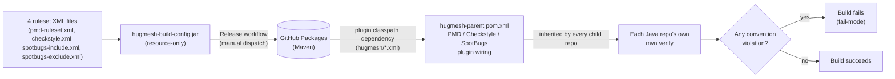

# hugmesh-build-config

A tiny, **resource-only JAR** that carries the HugMesh ecosystem's shared
static-analysis rulesets:

```
groupId:    net.hugmesh
artifactId: hugmesh-build-config
version:    0.5.0
packaging:  jar
```

It contains no Java — only ruleset XML under
`src/main/resources/hugmesh/`:

| File | Tool | Conventions enforced |
|------|------|----------------------|
| `pmd-ruleset.xml`     | PMD       | **A** `FinalFieldCouldBeStatic` (constants → `static final`), **B** `ImmutableField` (write-once fields → `final`) |
| `checkstyle.xml`      | Checkstyle | **F** `VisibilityModifier` (private fields), **G** `FinalClass` + `HideUtilityClassConstructor` + `MutableException` (final/utility/immutable-exception classes), **H** `LambdaBodyLength` (oversized lambda guardrail) |
| `spotbugs-include.xml`| SpotBugs core | **D** `EI_EXPOSE_REP`/`EI_EXPOSE_REP2`/`MS_EXPOSE_REP`/`MS_MUTABLE_*`/`MS_PKGPROTECT` (defensive copies / no rep exposure), **E** `MS_SHOULD_BE_FINAL`/`MS_CANNOT_BE_FINAL` (no mutable static) |
| `spotbugs-include.xml`| FindSecBugs 1.14.0 | 137 of its 144 security patterns (SQL/LDAP/XPath/EL injection, path traversal, weak crypto + hard-coded keys, unsafe deserialization, XXE, SSRF, cookie/CORS/CSRF config, XSS). The other 7 currently fire and are listed, with the reason each is held back, in the file's own header. |
| `spotbugs-exclude.xml`| SpotBugs | The known-pattern **baseline**: entity/dto/model packages (EI_EXPOSE_REP/EI_EXPOSE_REP2), generated sources, and test classes. Also suppresses EI_EXPOSE_REP2 (but NOT EI_EXPOSE_REP) for Spring-managed components — matched both by component *package* and, since 0.4.0, by *class-name suffix* (`*Service`/`*Controller`/`*Repository`/`*Client`/`*Config`/`*Handler`/`*Filter`/`*Resolver`), because the fleet uses feature packages rather than layer packages. Guarded so a `byte[]`/`char[]` key or token, or a mutable collection/date, still reports even inside those classes. |

## Status

Verified this pass against the actual current code/config (not prior doc claims):

- **Resource-only jar, no Java, no `src/test`** — `find src -type f` turns up only
  the 4 XML files under `src/main/resources/hugmesh/`. There is nothing to
  unit-test here beyond the package build itself.
- **`mvn -o package` builds cleanly offline** (verified this pass) and produces
  `target/hugmesh-build-config-0.5.0.jar` containing exactly the 4 resources
  at the bare `hugmesh/<file>.xml` path the plugins expect — the distribution
  mechanism described below is real, not aspirational.
- **All three analysers (PMD, Checkstyle, SpotBugs) are in fail-mode fleet-wide**,
  confirmed by reading `hugmesh-parent`'s current `pom.xml` directly: PMD
  flipped to `pmd:check`/`failOnViolation=true` in parent commit `2363e60`,
  Checkstyle in `ef31599`, SpotBugs in `7d22f1a` (all merged 2026-06-23/24). This
  repo's own docs had drifted behind that (still said PMD/SpotBugs were
  warn-first) — corrected in this pass; see "Rollout" below.
- `EI_EXPOSE_REP2` suppression for Spring-managed component packages
  (constructor-injection false positive) has shipped since 0.3.0 and is present
  in `spotbugs-exclude.xml` — but it matched on *package path* and the fleet uses
  *feature* packages, so it caught almost nothing it was written to catch
  (measured: 4 of hugmesh-admin-bff-api's 185 injection findings). 0.4.0 adds the
  class-name-suffix rule that actually covers the intended case.
- **FindSecBugs had never reported anything.** `spotbugs-include.xml` is an
  INCLUDE filter and named only the 9 D/E patterns; FindSecBugs' 144 patterns
  share none of those names (verified against the plugin's own `findbugs.xml`),
  so every security finding was filtered out before it could be reported. 0.4.0
  admits the 137 patterns measured at zero findings fleet-wide, which turns the
  security gate on for future code at zero cost to current builds.
- No test suite and no changelog file exist in this repo — not a gap, just not
  applicable to a 4-file resource jar; version history is the git log. The
  release workflow (`.github/workflows/release.yml`) is described under
  "Publishing".

## Why a separate artifact (the distribution mechanism)

Static-analysis plugins resolve a ruleset from **their own plugin
classpath**, not the project's compile classpath. So `hugmesh-parent` adds
this jar to each analysis plugin's `<dependencies>` and points the plugin at
a classpath path (no `classpath:` prefix — that prefix causes
`maven-pmd-plugin`/`spotbugs-maven-plugin` to fail with "Could not find
resource"): Checkstyle and SpotBugs use the bare `hugmesh/<file>.xml`, PMD uses
`/hugmesh/pmd-ruleset.xml` with a leading slash. Because the parent inherits into every Java
repo, every repo gets the same audited rulesets automatically — **no per-repo XML
copy**.

This is kept **separate from `hugmesh-commons`** (the runtime security library)
on purpose: a ruleset tweak must not force a version bump of a runtime artifact,
and build-config must not drag Spring onto any plugin classpath. It is the standard
enterprise "shared build config artifact" pattern (cf. how `google-checks`/
`sun_checks` ship inside the checkstyle jar).



## Conventions mapping (the standard)

The conventions come from the org's secure/clean-Java + reactive-readability
standard. Each item maps to the most precise tool:

- **A** static-final constants → PMD `FinalFieldCouldBeStatic`
- **B** final write-once fields → PMD `ImmutableField`
- **D** defensive copies / no rep exposure → SpotBugs core `EI_EXPOSE_REP*` / `MS_EXPOSE_REP` / `MS_MUTABLE_*` / `MS_PKGPROTECT` (these are core patterns only — FindSecBugs does *not* reuse these names; it has its own 144-pattern namespace, admitted separately in `spotbugs-include.xml`)
- **E** mutable static → SpotBugs `MS_SHOULD_BE_FINAL` / `MS_CANNOT_BE_FINAL`
- **F** field visibility → Checkstyle `VisibilityModifier`
- **G** final/utility/immutable-exception classes → Checkstyle `FinalClass` + `HideUtilityClassConstructor` + `MutableException`
- **H** reactive readability → Checkstyle `LambdaBodyLength` (size guardrail only)

**C** (enum for fixed string sets) and the *defensive-copy fix* / *lambda→method-ref*
/ *nesting* halves of D and H have **no reliable low-noise static rule**, so they
stay agent-pass conventions — we deliberately do not add a rule that flags every
lambda or every collection field.

## Rollout: fail-mode (all three tools)

All three analysers now run in **fail-mode** in `hugmesh-parent`: PMD (`pmd:check`, `failOnViolation=true`, flipped fleet-wide once verified clean), Checkstyle (`checkstyle:check`, `failOnViolation=true`, `severity=error` set here in `checkstyle.xml`), and SpotBugs (`spotbugs:check`, `failOnError=true` since parent PR #15). On the SpotBugs `check` goal `failOnError` is the *only* fail switch, and it gates real findings and SpotBugs-internal analysis errors together — the two are not separable, and an internal error means the gate never actually ran, so failing is correct. `failOnViolation` is **not** a parameter of that goal (it belongs to maven-pmd-plugin / maven-checkstyle-plugin); it was silently ignored, which is why the SpotBugs gate actually sat fail-**open** from `7d22f1a` until parent PR #15. Do not re-add it. A violation of any A/B/D/E/F/G/H convention now fails `mvn verify` fleet-wide. `${hugmesh.analysis.skip}` remains available in `hugmesh-parent` as an escape hatch for fast inner-loop builds.

## Building / testing locally

There is no Java to compile and no `src/test` — "testing" a ruleset change means
building the jar and re-running a consuming repo's analysis against it:

```bash
# 1. Build + install this jar into ~/.m2 so sibling repos resolve it offline.
mvn install

# 2. In a consuming repo (any Java repo that inherits hugmesh-parent),
#    re-run analysis to pick up the locally-installed jar:
mvn verify -Dhugmesh-build-config.version=<version you just installed>
```

`mvn -o package` (offline, no network) is enough to sanity-check the jar itself
builds and packages the 4 resources correctly — no external repository access is
required since this artifact has no `<dependencies>` beyond the pinned
`maven-jar-plugin`.

## Publishing

Publishing is the `Release` GitHub Actions workflow
(`.github/workflows/release.yml`), `workflow_dispatch` only — never on push or
tag. It runs `mvn package`, then `mvn deploy` to GitHub Packages
(`https://maven.pkg.github.com/hugmesh/hugmesh-build-config`) with the
workflow's own `GITHUB_TOKEN` — **no secret committed**. This jar is link 1 of 4
in the org's publish chain (`hugmesh-build-config` → `hugmesh-parent` →
`hugmesh-commons` → `hugmesh-auth-core`); see `RELEASING.md` in this repo.

- Bump `<version>` in the same PR as any ruleset change: a ruleset change
  published at the same coordinate silently changes what the whole fleet is
  analysed against.
- Bump `project.build.outputTimestamp` in `pom.xml` to the release date when you
  bump the version (it makes the jar reproducible).

The repo still carries a GitLab pipeline, `.gitlab-ci.yml`, that packages the jar
and (on the default branch / a tag) deploys it via `mvn deploy -s settings.xml`
to the GitLab Maven Package Registry, authenticated with the GitLab-injected
`CI_JOB_TOKEN`. `pom.xml`'s `distributionManagement` still points there; the
GitHub workflow overrides it with `-DaltDeploymentRepository`. For local dev,
`mvn install` writes the jar to `~/.m2` so sibling repos resolve it offline.

## Known Gaps / TODO

- No issues are open against this repo.
- Stale text: the header of `pmd-ruleset.xml`, the `<description>` in `pom.xml`
  and the comment above its `<build>` say the plugins read the bare path
  `hugmesh/<file>.xml`. That holds for Checkstyle and SpotBugs; PMD uses
  `/hugmesh/pmd-ruleset.xml` in `hugmesh-parent`. Fixing the text changes the
  jar and the pom, so it waits for the next version bump.
