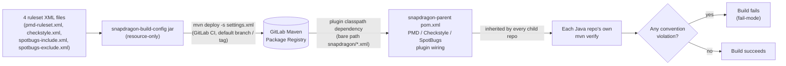

# snapdragon-build-config

A tiny, **resource-only JAR** that carries the Snapdragon ecosystem's shared
static-analysis rulesets:

```
groupId:    systems.snapdragon
artifactId: snapdragon-build-config
version:    0.3.0
packaging:  jar
```

It contains no Java — only ruleset XML under
`src/main/resources/snapdragon/`:

| File | Tool | Conventions enforced |
|------|------|----------------------|
| `pmd-ruleset.xml`     | PMD       | **A** `FinalFieldCouldBeStatic` (constants → `static final`), **B** `ImmutableField` (write-once fields → `final`) |
| `checkstyle.xml`      | Checkstyle | **F** `VisibilityModifier` (private fields), **G** `FinalClass` + `HideUtilityClassConstructor` + `MutableException` (final/utility/immutable-exception classes), **H** `LambdaBodyLength` (oversized lambda guardrail) |
| `spotbugs-include.xml`| SpotBugs + FindSecBugs | **D** `EI_EXPOSE_REP`/`EI_EXPOSE_REP2`/`MS_EXPOSE_REP`/`MS_MUTABLE_*` (defensive copies / no rep exposure), **E** `MS_SHOULD_BE_FINAL` (no mutable static) |
| `spotbugs-exclude.xml`| SpotBugs | The known-pattern **baseline**: entity/dto/model packages (EI_EXPOSE_REP/EI_EXPOSE_REP2), generated sources, and test classes. Also suppresses EI_EXPOSE_REP2 (but NOT EI_EXPOSE_REP) for Spring-managed component packages (controller/service/client/config/repository/etc.) where constructor-injected beans are not an encapsulation leak. |

## Status

Verified this pass against the actual current code/config (not prior doc claims):

- **Resource-only jar, no Java, no `src/test`** — `find src -type f` turns up only
  the 4 XML files under `src/main/resources/snapdragon/`. There is nothing to
  unit-test here beyond the package build itself.
- **`mvn -o package` builds cleanly offline** (verified this pass) and produces
  `target/snapdragon-build-config-0.3.0.jar` containing exactly the 4 resources
  at the bare `snapdragon/<file>.xml` path the plugins expect — the distribution
  mechanism described below is real, not aspirational.
- **All three analysers (PMD, Checkstyle, SpotBugs) are in fail-mode fleet-wide**,
  confirmed by reading `snapdragon-parent`'s current `pom.xml` directly: PMD
  flipped to `pmd:check`/`failOnViolation=true` in parent commit `2363e60`,
  Checkstyle in `ef31599`, SpotBugs in `7d22f1a` (all merged 2026-06-23/24). This
  repo's own docs had drifted behind that (still said PMD/SpotBugs were
  warn-first) — corrected in this pass; see "Rollout" below.
- `EI_EXPOSE_REP2` suppression for Spring-managed component packages
  (constructor-injection false positive) has shipped since 0.3.0 and is present
  in `spotbugs-exclude.xml`.
- No test suite, no CI badge/status page, no changelog file exist in this repo —
  not a gap, just not applicable to a 4-file resource jar; version history is the
  git log.

## Why a separate artifact (the distribution mechanism)

Static-analysis plugins resolve a ruleset from **their own plugin
classpath**, not the project's compile classpath. So `snapdragon-parent` adds
this jar to each analysis plugin's `<dependencies>` and points the plugin at
the bare classpath path `snapdragon/<file>.xml` (no `classpath:` prefix — that
prefix causes `maven-pmd-plugin`/`spotbugs-maven-plugin` to fail with
"Could not find resource"). Because the parent inherits into every Java
repo, every repo gets the same audited rulesets automatically — **no per-repo XML
copy**.

This is kept **separate from `snapdragon-commons`** (the runtime security library)
on purpose: a ruleset tweak must not force a version bump of a runtime artifact,
and build-config must not drag Spring onto any plugin classpath. It is the standard
enterprise "shared build config artifact" pattern (cf. how `google-checks`/
`sun_checks` ship inside the checkstyle jar).



## Conventions mapping (the standard)

The conventions come from the org's secure/clean-Java + reactive-readability
standard. Each item maps to the most precise tool:

- **A** static-final constants → PMD `FinalFieldCouldBeStatic`
- **B** final write-once fields → PMD `ImmutableField`
- **D** defensive copies / no rep exposure → SpotBugs + FindSecBugs `EI_EXPOSE_REP*` / `MS_EXPOSE_REP` / `MS_MUTABLE_*`
- **E** mutable static → SpotBugs `MS_SHOULD_BE_FINAL`
- **F** field visibility → Checkstyle `VisibilityModifier`
- **G** final/utility/immutable-exception classes → Checkstyle `FinalClass` + `HideUtilityClassConstructor` + `MutableException`
- **H** reactive readability → Checkstyle `LambdaBodyLength` (size guardrail only)

**C** (enum for fixed string sets) and the *defensive-copy fix* / *lambda→method-ref*
/ *nesting* halves of D and H have **no reliable low-noise static rule**, so they
stay agent-pass conventions — we deliberately do not add a rule that flags every
lambda or every collection field.

## Rollout: fail-mode (all three tools)

All three analysers now run in **fail-mode** in `snapdragon-parent`: PMD (`pmd:check`, `failOnViolation=true`, flipped fleet-wide once verified clean), Checkstyle (`checkstyle:check`, `failOnViolation=true`, `severity=error` set here in `checkstyle.xml`), and SpotBugs (`spotbugs:check`, `failOnViolation=true`; `failOnError=false` is kept so a SpotBugs *internal* error, e.g. a missing class, never fails the build spuriously — that is independent of violation fail-mode). A violation of any A/B/D/E/F/G/H convention now fails `mvn verify` fleet-wide. `${snapdragon.analysis.skip}` remains available in `snapdragon-parent` as an escape hatch for fast inner-loop builds.

## Building / testing locally

There is no Java to compile and no `src/test` — "testing" a ruleset change means
building the jar and re-running a consuming repo's analysis against it:

```bash
# 1. Build + install this jar into ~/.m2 so sibling repos resolve it offline.
mvn install

# 2. In a consuming repo (any Java repo that inherits snapdragon-parent),
#    re-run analysis to pick up the locally-installed jar:
mvn verify -Dsnapdragon-build-config.version=<version you just installed>
```

`mvn -o package` (offline, no network) is enough to sanity-check the jar itself
builds and packages the 4 resources correctly — no external repository access is
required since this artifact has no `<dependencies>` beyond the pinned
`maven-jar-plugin`.

## Publishing

CI packages and (on the default branch / a tag) deploys the jar to the GitLab
Maven Package Registry via `mvn deploy -s settings.xml`, authenticated with the
GitLab-injected `CI_JOB_TOKEN` — **no secret committed**. There is no GitHub
Actions pipeline; CI is GitLab. For local dev, `mvn install` writes the jar to
`~/.m2` so sibling repos resolve it offline.

## Known Gaps / TODO

- None open against this repo's own backlog (checked `platform-todo-queue` and
  other session-memory notes for `build-config` / `snapdragon-build-config` /
  ruleset-related entries — no matches).
- **Fixed this pass:** the "Rollout" section and the `ROLLOUT:` header comments
  in `pmd-ruleset.xml`, `checkstyle.xml` and `spotbugs-include.xml` all still
  claimed PMD and SpotBugs ran warn-first. Reading `snapdragon-parent`'s current
  `pom.xml` directly showed all three analysers were already flipped to
  fail-mode (parent commits `2363e60`, `ef31599`, `7d22f1a`, 2026-06-23/24) —
  before even this repo's own most recent "docs sync" commits, which missed the
  drift. Corrected everywhere in this pass.
- A prior pass fixed a stale `pom.xml` comment above `<build>` that said plugins
  resolve `classpath:/snapdragon/<file>.xml`, contradicting the bare-path
  wording already correct elsewhere.
